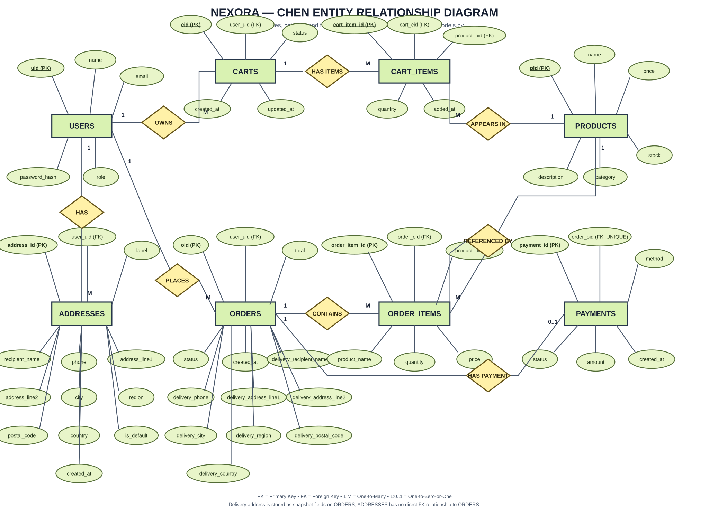

# NEXORA ER Diagram

The diagram is styled to match the supplied Chen-notation reference: green entity rectangles, yellow relationship diamonds, oval attributes, underlined primary keys, connecting lines, and 1/M cardinalities.

It is based on the exact SQLAlchemy schema in `backend/app/models.py`.

## Entities
USERS, PRODUCTS, CARTS, CART_ITEMS, ADDRESSES, ORDERS, ORDER_ITEMS, PAYMENTS.

## Relationships
- USERS 1:M CARTS
- USERS 1:M ADDRESSES
- USERS 1:M ORDERS
- CARTS 1:M CART_ITEMS
- PRODUCTS 1:M CART_ITEMS
- ORDERS 1:M ORDER_ITEMS
- PRODUCTS 1:M ORDER_ITEMS
- ORDERS 1:0..1 PAYMENTS

Product category is an attribute of PRODUCTS, not a separate table. Wishlist tables are not part of the current model. Delivery address fields are stored directly on ORDERS; there is no address foreign key on ORDERS.
